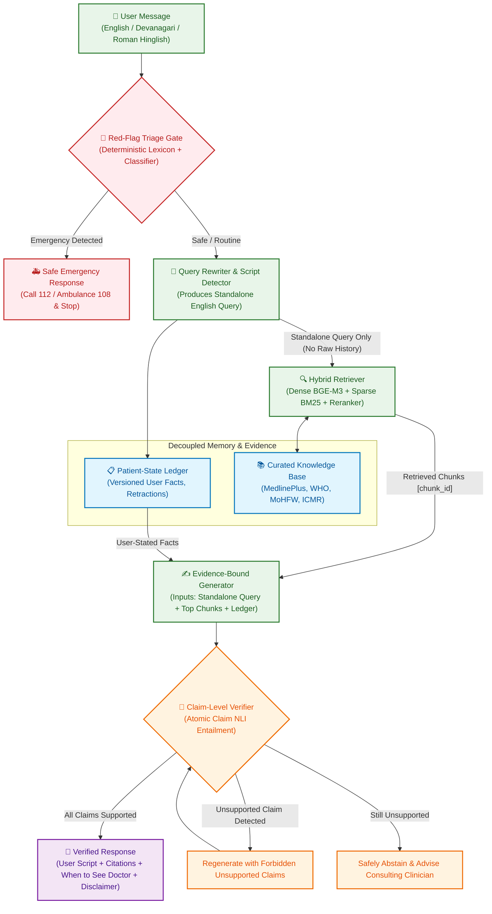

# MedDriftGuard 🛡️🩺

> **Stopping Conversational Hallucination Drift in Hinglish Patient-Facing Health RAG**  
> *Major Project Phase-II & Research Paper*  
> **Team:** IILM University, B.Tech CSE · **Guide:** Ms. Bhumika Pal

---

## 🌟 Overview

Conversational medical chatbots built on standard Retrieval-Augmented Generation (RAG) suffer from a critical, documented failure mode: **as conversations become longer, the risk of medical hallucination rises significantly**. 

In multilingual and code-mixed settings—such as Indian patients communicating in **Hinglish** (Roman-script Hindi) or **Devanagari Hindi** alongside English—the failure is amplified:
1. Standard query concatenation pollutes the retrieval context with obsolete symptoms or conversational chit-chat.
2. The language model blends past conversational topics into current clinical guidance.
3. Language switching causes retrieval drop-offs (the "script gap").

**MedDriftGuard** solves this problem by introducing a novel, decoupled architecture:
- **Patient-State Ledger**: An explicit, versioned, and editable record of user-stated facts (symptoms, duration, allergies), isolated from the medical evidence store.
- **Standalone Current-Turn Rewriter**: Reformulates the user's latest query into a focused English search query without history bloat.
- **Deterministic Red-Flag Triage Gate**: Immediately intercepts medical emergencies (chest pain, stroke signs, severe trauma) before any LLM processing.
- **Evidence-Bound Generator & Claim Verifier**: Constrains generation strictly to retrieved authoritative evidence and verifies every atomic claim with an NLI entailment model.

---

## 📐 Architecture Diagram



---

## 🔬 Core Contributions

1. **C1 — DriftGuard Architecture**: Decoupled patient-state ledger, current-turn standalone retrieval, atomic claim verification, and deterministic emergency triage.
2. **C2 — HHDB Benchmark (Hinglish Health Drift Benchmark)**: 300 curated multi-turn clinical conversations (3–15 turns) across 3 script variants (English, Devanagari Hindi, Roman Hinglish) with built-in drift traps (topic switching, pronoun follow-ups, user corrections, leak tests).
3. **C3 — Scientific Drift Evaluation**: Rigorous evaluation measuring the **Unsupported-Claim Rate (UCR) vs. Turn Depth**, demonstrating that MedDriftGuard maintains flat error rates across extended conversations where traditional RAG fails.

---

## 🛡️ Medical Safety & Ethics Guardrails

- **Information Only**: MedDriftGuard is an informational awareness assistant. It **never diagnoses** medical conditions.
- **Zero Drug Dosing**: The knowledge base and models are strictly prohibited from indexing, training on, or generating pharmaceutical drug dosages or titration schedules.
- **Deterministic Triage**: Emergency signs (e.g. chest pain, stroke signs, difficulty breathing) trigger instantaneous hard-coded emergency instructions (112 / 108) without querying the LLM.
- **Privacy by Design**: No real patient data is ever used. No personally identifiable information (PII) is recorded in logs or evaluation traces.

---

## 📂 Repository Structure

```text
meddriftguard/
├── .agent/                          # Antigravity agent configuration
│   ├── rules/project.md             # Engineering and safety rules
│   └── workflows/                   # Saved workflows (/run-eval, /safety-check, /phase-report)
├── configs/                         # Declarative YAML configurations
│   ├── pipeline.yaml                # Master pipeline settings
│   ├── retriever.yaml               # Hybrid search & reranker settings
│   ├── models.yaml                  # Open model definitions
│   ├── triage.yaml                  # Red-flag emergency lexicon & emergency numbers
│   ├── verifier.yaml                # NLI entailment threshold configurations
│   ├── eval.yaml                    # Evaluation benchmarks & metrics
│   ├── train_m1.yaml                # Rewriter QLoRA training parameters
│   └── train_m2.yaml                # Multilingual triage classifier training parameters
├── kb/                              # Curated Knowledge Base
│   ├── SOURCES.md                   # Approved source URLs, licenses, and scopes
│   ├── raw/                         # Raw downloaded files
│   ├── clean/                       # Cleaned text sections
│   └── index/                       # Dense & sparse retrieval indices
├── src/                             # Source code
│   ├── triage/                      # Deterministic red-flag triage gate
│   ├── rewriter/                    # Conversational query normalizer & rewriter
│   ├── ledger/                      # Patient-state ledger (versioned facts)
│   ├── retriever/                   # Hybrid retriever (BGE-M3 + BM25 + Reranker)
│   ├── generator/                   # Evidence-bound response generator
│   ├── verifier/                    # Atomic claim-level NLI verifier
│   ├── pipeline/                    # End-to-end orchestration pipeline
│   ├── api/                         # FastAPI service application
│   ├── ui/                          # Streamlit conversational web interface
│   └── common/                      # Shared schemas, logging, seeds, i18n
├── data/                            # Datasets & Benchmarks
│   ├── synthetic/                   # Synthetic training samples (behaviour only)
│   ├── hhdb/                        # Hinglish Health Drift Benchmark (train/dev/test)
│   ├── redteam/                     # Red-team adversarial safety suite
│   ├── review_sheets/               # Medical reviewer spot-check sheets
│   └── human_eval/                  # Human rater evaluation protocol
├── training/                        # Training scripts & notebooks
├── eval/                            # Evaluation scripts & metric calculators
├── results/                         # Experiment outputs, metrics, and plots
├── docs/                            # Documentation & phase reports
│   ├── hypotheses.md                # Pre-registered scientific hypotheses
│   └── phase_0.md                   # Phase 0 scaffold verification report
├── tests/                           # Automated test suite
│   ├── unit/                        # Unit tests for schemas and modules
│   ├── integration/                 # End-to-end pipeline integration tests
│   └── fixtures/                    # Test conversation fixtures
├── pyproject.toml                   # Project dependencies and tool settings
├── Makefile                         # Automation commands (setup, test, lint, eval)
├── make.bat                         # Windows runner script
└── .env.example                     # Environment configuration template
```

---

## 🚀 Quick Start

### 1. Requirements
- Python 3.11+
- Virtual environment (recommended)

### 2. Setup
Clone the repository and install dependencies:
```bash
# Using pip
pip install -e .[dev]

# On Linux/macOS
make setup

# On Windows
.\make.bat setup
```

### 3. Running Unit Tests
```bash
# On Linux/macOS
make test

# On Windows
.\make.bat test

# Or directly using pytest
python -m pytest tests/unit -v
```

### 4. Running the API Server
```bash
# Launch FastAPI development server
uvicorn src.api.main:app --reload --host 127.0.0.1 --port 8000
```
Open your browser to `http://127.0.0.1:8000/health` to confirm the API is running.

---

## 📋 Implementation Roadmap

| Phase | Description | Status |
|:---:|---|:---:|
| **P0** | **Project scaffolding, configuration, Pydantic schemas, unit tests, and README** | ✅ Completed |
| **P1** | Medical knowledge-base ingestion pipeline (approved sources, section chunking, license tracking) | ⏳ Next |
| **P2** | Hybrid retriever (BGE-M3 dense embeddings, BM25 keyword search, RRF fusion, reranker) | 📅 Planned |
| **P3** | Patient-state ledger & prompted rewriter (handling corrections, follow-ups, topic shifts) | 📅 Planned |

---

## 📜 License
Apache-2.0 License. See `LICENSE` for details.
